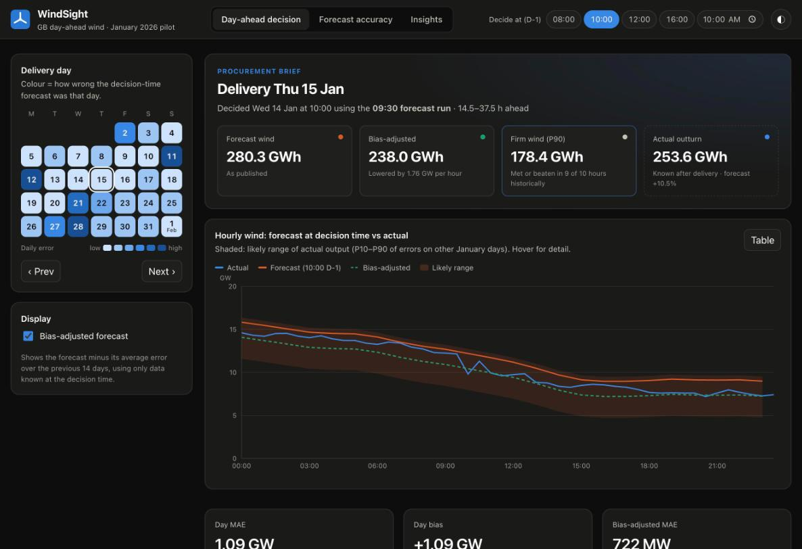
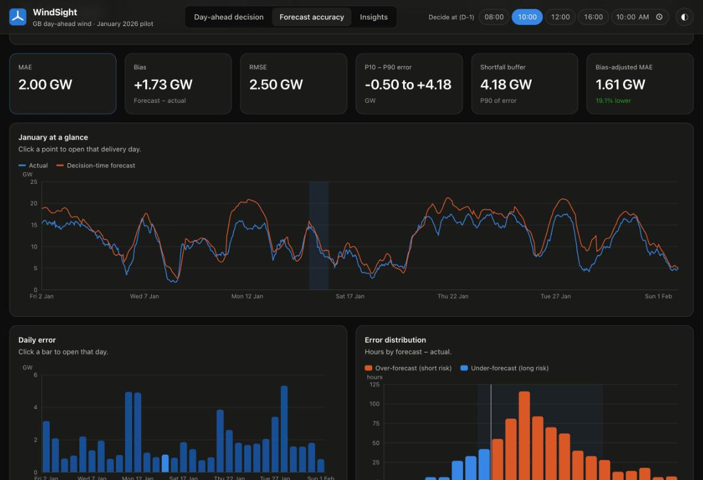
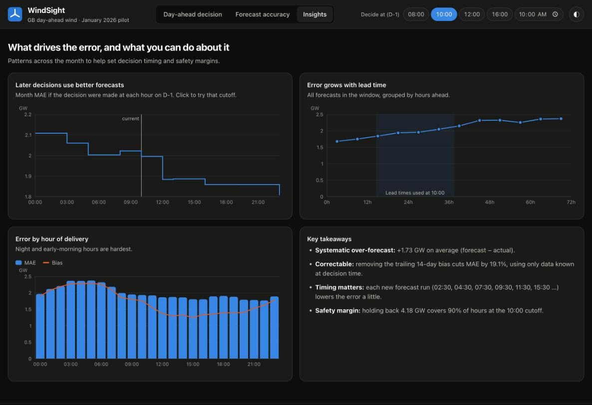

# WindSight: day-ahead wind forecast decision support

WindSight helps a GB energy-supplier trading desk that buys power on the **day-ahead market**:

1. **See the latest wind forecast that was available when the purchase decision was made.**
   For delivery day *D*, the decision is made on *D-1* at a cutoff time (default **10:00 UK**).
   For every hour of *D*, WindSight picks the most recent forecast published at or before that
   cutoff, which is exactly what the desk could have known at that moment.
2. **Quantify how accurate those forecasts were**, so the desk can size the extra (e.g. thermal)
   volume it buys with the error in mind: MAE, RMSE, bias, P10–P90 error band, a P90
   "shortfall buffer", error by hour, by day, by lead time, and by decision time.

Scope: GB national **wind** only, from Elexon BMRS:
[FUELHH](https://bmrs.elexon.co.uk/api-documentation/endpoint/datasets/FUELHH/stream) (actuals, `fuelType=WIND`)
and [WINDFOR](https://bmrs.elexon.co.uk/api-documentation/endpoint/datasets/WINDFOR/stream) (forecasts), limited to
purchase decisions made in **January 2026**.

> **Live app:** https://zbhkrv.vercel.app
>
> **API docs (OpenAPI):** https://zbhkrv.vercel.app/docs

## Screenshots

**Day-ahead decision:** the forecast available at the D-1 cutoff for a chosen delivery day, a procurement brief
(forecast, bias-adjusted, firm P90 and actual energy) and the hourly chart with its likely range.



**Forecast accuracy:** month-level error metrics, decision-time forecast vs actual for all of January, daily
error and the error distribution.



**Insights:** how the decision time, forecast lead time and hour of delivery affect the error, with key takeaways.



---

## Key findings (10:00 cutoff, decisions 1–31 Jan 2026)

| Metric | Value |
|---|---|
| Hours evaluated | 744 (31 delivery days × 24 h) |
| Mean absolute error | **2.00 GW** (17.7% of mean output of 11.29 GW) |
| Bias (forecast − actual) | **+1.73 GW**: forecasts were too high in 84% of hours |
| RMSE | 2.50 GW |
| P10 – P90 of error | −0.50 GW to +4.18 GW |
| P90 shortfall buffer | 4.18 GW (plan for this much less wind to be covered in 9 of 10 hours) |
| Bias-adjusted MAE (trailing 14-day bias, causal) | **1.61 GW (−19%)** |

* Error grows with lead time: about 1.7 GW MAE for forecasts 0–6 h ahead, rising to about 2.3 GW at 42 h+.
  At a 10:00 D-1 cutoff the forecasts used are 14.5–37.5 h ahead.
* Deciding later on D-1 helps a little (MAE 2.00 GW at 10:00, 1.88 GW at 12:00, 1.86 GW at 16:00),
  because a newer forecast run becomes available.
* The hardest days were 28 Jan, 11–12 Jan and 21 Jan (daily MAE 3.9–5.3 GW, all over-forecasts).
* The persistent over-forecast may partly reflect wind curtailment and differences in what each dataset
  covers. That is a hypothesis for follow-up, not something this pilot proves.

## Assumptions and design decisions

| Topic | Decision |
|---|---|
| Decision time | Delivery day D is bought on D-1 before a cutoff (default 10:00 Europe/London, adjustable in the UI). |
| "Decisions in January 2026" | Decision days 1–31 Jan ⇒ delivery days **2 Jan – 1 Feb 2026**. |
| Forecast selection | Per target hour: the forecast with the latest `publishTime ≤ cutoff`. Rows whose `startTime` is before their `publishTime` are dropped. |
| Resolution mismatch | WINDFOR is hourly and FUELHH is half-hourly. Accuracy is measured on identical `startTime`s (the :00 half-hour of each hour). Charts show the full half-hourly actuals. |
| Actual revisions | FUELHH is de-duplicated per `startTime`, keeping the latest `publishTime`. |
| Partial coverage | Forecast runs published before about 02:30 on D-1 end at 21:00 on D, so with very early cutoffs the last hours of D have no forecast. Those hours are left unscored, the UI says so, and energy totals compare only covered hours. |
| Error sign | `error = forecast − actual`. Positive ⇒ less wind than forecast ⇒ desk would be **short**. |
| Relative error | nMAE (MAE ÷ mean actual) instead of MAPE, which blows up in low-wind hours. |
| Uncertainty band | P10–P90 of errors on the **other** days of the month (leave-one-day-out), so a day never informs its own band. This is an **evaluation** view: it also uses days after D. In production it would use a trailing window (too few samples in early January for that here). |
| Bias adjustment | Forecast minus the mean error of delivery days D-15…D-2. Only actuals complete at the D-1 cutoff are used (causal). Shown as an illustration, not a new model. |
| Data at runtime | A committed snapshot (`backend/data/snapshot.json`), so the app is fast, reproducible and independent of Elexon uptime. Refresh it with the fetch script. |

## Architecture

```
 Elexon BMRS API ──(scripts/fetch_snapshot.py, offline)──► backend/data/snapshot.json
                                                                   │ loaded once, cached
 Browser (React + Recharts) ──/api/*──► FastAPI (app/main.py) ──► app/analysis.py (pure functions)
          ▲                                   │
          └────── built React app served by FastAPI in the container (STATIC_DIR)
```

* **Backend (Python 3.11, FastAPI):** all domain logic is in `app/analysis.py` as pure,
  unit-tested functions. `app/main.py` is a thin HTTP layer with input validation and
  `lru_cache` on results, which is safe because the snapshot is immutable.
* **Frontend (React 19, TypeScript, Vite, Recharts):** three tabs (**Day-ahead decision**, **Forecast accuracy**,
  **Insights**) under a top bar with a global decision-cutoff control (presets plus a custom time). The decision tab
  has a calendar heatmap for picking the delivery day (coloured by that day's error), a "procurement brief" with
  forecast, bias-adjusted, firm (P90) and actual energy, and the hourly chart with a table view. Light and dark themes;
  clicking a day in the month charts opens it.
* **Container:** a multi-stage `Dockerfile` (Node builds the UI, a slim Python image serves API + UI) on one port.
* **Vercel deployment:** the React build is served as static files and `/api/*` is routed to a Python
  serverless function (`api/index.py`) that wraps the same FastAPI app and bundles the data snapshot.

### API

| Endpoint | Description |
|---|---|
| `GET /api/health` | Liveness |
| `GET /api/meta` | Delivery days, default cutoff, data source and fetch time |
| `GET /api/day?date=YYYY-MM-DD&cutoff=HH:MM` | Decision-time forecast, actuals, likely-range band, bias-adjusted forecast and metrics for one delivery day |
| `GET /api/accuracy?cutoff=HH:MM` | Month metrics, by-hour, by-day, error histogram and hourly series |
| `GET /api/insights` | Accuracy by lead time; month MAE for each hourly cutoff 00:00–23:00 |

Interactive API docs: `http://localhost:8000/docs`.

## Repository layout

```
.
├── backend/
│   ├── app/
│   │   ├── analysis.py        # forecast selection + metrics (pure, tested)
│   │   ├── config.py          # decision/delivery window, default cutoff, data path
│   │   ├── elexon.py          # Elexon BMRS client (WINDFOR, FUELHH)
│   │   └── main.py            # FastAPI routes; serves built frontend if STATIC_DIR set
│   ├── data/snapshot.json     # January 2026 data snapshot (compact JSON)
│   ├── scripts/fetch_snapshot.py  # re-downloads the snapshot from Elexon
│   ├── tests/                 # pytest: unit tests (synthetic data) + API tests (snapshot)
│   ├── requirements.txt / requirements-dev.txt / pytest.ini
├── frontend/
│   ├── src/
│   │   ├── App.tsx            # top bar, tabs, decision/accuracy/insights views
│   │   ├── useApi.ts          # fetch hook that keeps the previous data while reloading
│   │   ├── api.ts             # typed API client
│   │   ├── format.ts          # UK-time and MW/GW formatting
│   │   ├── components/charts.tsx  # all Recharts charts
│   │   ├── components/ui.tsx  # Card, Kpi, Legend, tooltip box
│   │   ├── index.css          # design tokens (light/dark) and shared components
│   │   └── layout.css         # app shell, tabs, calendar, procurement brief
│   ├── vite.config.ts         # dev proxy /api -> :8000
│   └── package.json
├── docs/screenshots/          # UI screenshots used in this README
├── api/index.py               # Vercel serverless entry point (wraps the FastAPI app)
├── vercel.json                # Vercel build, function and routing config
├── requirements.txt           # Python deps for the Vercel function
├── Dockerfile                 # multi-stage build: UI + API in one image
├── docker-compose.yml
└── README.md
```

## Running the app

### Option A: container (Docker or Podman)

```bash
docker compose up --build          # or: podman-compose up --build
# open http://localhost:8000
```

Without compose: `docker build -t windsight . && docker run -p 8000:8000 windsight`
(swap `docker` for `podman` if you use Podman). The image honours a `PORT` env var for PaaS hosts.

### Option B: local development (hot reload)

Requirements: Python 3.11+, Node 20+.

```bash
# backend
cd backend
python3 -m venv .venv && source .venv/bin/activate
pip install -r requirements-dev.txt
uvicorn app.main:app --reload --port 8000

# frontend (second terminal)
cd frontend
npm install
npm run dev                        # http://localhost:5173 (proxies /api to :8000)
```

### Tests and checks

```bash
cd backend && pytest               # 18 tests: selection logic, metrics, API contract
cd frontend && npm run lint && npm run build   # oxlint + TypeScript type-check + build
```

### Deploying to Vercel

```bash
vercel --prod        # uses vercel.json: builds frontend/, deploys api/index.py as a Python function
```

### Refreshing the data

```bash
cd backend && python -m scripts.fetch_snapshot
```

## AI tool usage

AI coding tools were used to assist development (scaffolding, code, tests and documentation).
All assumptions, the methodology and the results were reviewed and verified by running the test
suite, checking API outputs against the raw Elexon data, and testing the UI in a browser.

## Possible next steps

* Add solar and demand forecasts to show a full "residual demand to procure" view.
* Replace the illustrative bias correction with a proper post-processing model (e.g. level-dependent
  or quantile regression) validated over a longer history.
* Scheduled data refresh (and a database) for live daily operation instead of a fixed snapshot.
